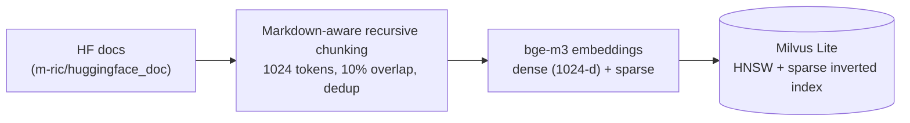
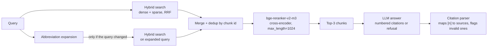

# RAG over the Hugging Face Documentation

An end-to-end retrieval-augmented generation (RAG) pipeline that answers questions about the Hugging Face docs with **cited answers**. It combines Markdown-aware chunking, hybrid (dense + sparse) search in Milvus, cross-encoder reranking, and an LLM that is required to cite its sources or refuse.

The part I care most about is the evaluation. Each design decision below came out of a measured failure analysis, and retrieval and generation are evaluated separately on a synthetic question set whose ground-truth chunk is known exactly.

[](https://colab.research.google.com/github/<GITHUB_USERNAME>/<REPO_NAME>/blob/main/notebooks/RAG_HuggingFaceDocs_Milvus.ipynb)

<!-- TODO: replace <GITHUB_USERNAME> and <REPO_NAME> in the badge link once the repo exists (the repo must be public for Colab to open it) -->

## Results at a glance

**Retrieval** (195 synthetic questions, one ground-truth chunk each, top-3 reranked context fed to the LLM)

| Recall@1 | Recall@3 | Recall@5 | Recall@10 | MRR@10 |
|---|---|---|---|---|
| 82.6% | 92.8% | 96.4% | 98.0% | 0.884 |

How to read this: the right chunk is ranked first for about 83% of questions, is in the top 3 (the context the LLM actually sees) for about 93%, and is missing from the top 10 for about 2% (4 of 195, all of them chunks that are just lists of paper citations in Korean or Russian docs). MRR@10 is the average of 1/rank of the first correct chunk within the top 10 (0 if absent). It sits barely above Recall@1, so almost all of the quality is in the top-1 hit. The remaining correct chunks mostly sit at ranks 2 and 3.

Numbers vary by about 1 to 2 points between identical runs (near-tied fp16 reranker scores and RRF ties). The figures above are from one run, and differences of that size are well inside the sampling error of a 195-question set.

**Generation** (same 195 questions, same retrieved chunks for every model)

| | Phi-3.5-mini (4-bit, T=0.7) | Phi-3.5-mini (fp16, T=0.3, citation reminder) | GPT-5.6 Luna (low reasoning effort) |
|---|---|---|---|
| Mean hallucination score (LLM judge, lower is better) | 0.119 | 0.078 | **0.016** |
| Answers flagged by the judge (score > 0) | 64 / 195 | 40 / 195 | **7 / 195** |
| Answers with no citation | 137 / 195 | 18 / 195 | **2 / 195** |
| Mean answer relevance | 0.969 | 0.976 | 0.961 |
| Latency p50 / p95 (s) | 19.1 / 26.0 | 10.5 / 16.2 | **1.3 / 2.5** |

After reading the 7 answers GPT-5.6 Luna was flagged on, **4 were real hallucinations and 3 were judge errors**. LLM-as-judge scores need spot-checking. The judge here is `gpt-4o-mini`.

Retrieval latency (hybrid search + reranking, measured from Opik traces) was 4.1 s p50 / 7.0 s p95 on a Google Colab T4 GPU. At the pricing used in the notebook, answering 195 questions with GPT-5.6 Luna costs about $0.11 (an estimate assuming ~1,500 input and ~200 output tokens per query).

## Example queries

```text
Q: What metrics gauge auto summaries vs. human refs in NLP?
A: ROUGE metrics gauge automatically produced summaries against
   human-produced reference summaries in NLP. [1]
   [1] huggingface/evaluate/blob/main/metrics/rouge/README.md

Q: How do I create an inference endpoint?
A: 1. Log in and open the Endpoint creation page. 2. Enter the repository ID
   and an endpoint name. 3. Select a cloud provider and region. ... [1]
   For a private endpoint, select Private and provide the AWS account ID... [2]
   [1] huggingface/hf-endpoints-documentation/.../create_endpoint.mdx
   [2] huggingface/blog/blob/main/inference-endpoints.md

Q: What is El Nino effect?                      (out of scope)
A: I don't have enough information to answer that.

Q: Which is the largest planet in our solar system?   (out of scope)
A: I don't have enough information to answer that.
```

The first query shows why abbreviation expansion exists. A plain dense search missed it in the baseline because the source docs say "natural language processing" and never use "NLP".

## Architecture

**Indexing (offline)**



**Query (online)**



| Component | Choice |
|---|---|
| Corpus | `m-ric/huggingface_doc`: 2,647 docs (1,915 `.md`, 468 `.mdx`, 264 `.ipynb`). The first 500 are indexed, giving **1,991 chunks** |
| Chunking | LangChain `RecursiveCharacterTextSplitter` with Markdown separators, sized in **tokens** of the embedding model's tokenizer |
| Embeddings | `BAAI/bge-m3` (multilingual; dense + sparse from one model) |
| Vector store | Milvus Lite (local); HNSW for dense, inverted index for sparse |
| Fusion | Reciprocal Rank Fusion (no weights to tune) |
| Reranker | `BAAI/bge-reranker-v2-m3` |
| Generator | `gpt-5.6-luna` (final); `Phi-3.5-mini-instruct` evaluated as the open-weight alternative |
| Observability / eval | Opik tracing, Opik `Hallucination` and `AnswerRelevance` metrics, custom retrieval metrics |

## How the system evolved

### Step 0: Baseline (dense only)
Fixed-size chunks (1,000 characters, 200 overlap) embedded with `bge-small-en-v1.5` and searched densely. Evaluated on 50 questions from the Ragas test-set generator:

| Recall@1 | Recall@3 | Recall@5 | Recall@10 | Recall@20 | MRR@20 |
|---|---|---|---|---|---|
| 0.24 | 0.50 | 0.58 | 0.64 | 0.70 | 0.38 |

### Step 1: Failure analysis
I read all 18 questions where the target chunk was not in the top 10. They fell into a few clear groups:

- **Non-English content** (Chinese, Russian, Korean docs). `bge-small-en` is an English model, so the multilingual docs were effectively unsearchable.
- **Chunks cut mid-sentence or mid-table.** This is a symptom of fixed-size splitting on Markdown.
- **Abbreviation mismatch.** The query said "NLP" and the document said "natural language processing".
- **Bad test cases.** Some targets were just lists of citations.

### Step 2: Changes, one per failure mode

| Failure mode | Change |
|---|---|
| Multilingual content | Switched to `bge-m3` |
| Exact-term and identifier matching | Added **sparse** vectors and fused them with dense using RRF (hybrid search) |
| Chunks cut mid-structure | **Recursive, Markdown-aware** splitting, measured in tokens |
| Abbreviations | A curated ~30-entry abbreviation map. The original and expanded queries are both searched, and the results are merged |
| Ranking quality within the candidate pool | Cross-encoder reranking over the merged candidates |

Ragas test-set generation also broke on dependency incompatibilities, so I wrote a custom question generator (below).

### Step 3: A better evaluation set
Each question is generated by an LLM from **one sampled chunk**, so the ground-truth chunk is known exactly. The prompt has a `skip` escape hatch for low-content chunks (headers, code fences, changelog entries). The sampling seed is fixed.

With one relevant chunk per question, Recall@k is effectively "was the source chunk in the top k" and Precision@k is capped at 1/k. Recall@k and MRR@k are the informative metrics. MRR@1 equals Recall@1 by construction, which is a useful sanity check on the implementation.

### Step 4: Two bugs found in review

An intermediate version scored 0.70 Recall@1 / 0.93 Recall@10 (191 questions). A code review found two bugs that were silently limiting retrieval:

1. **The Markdown separators were never applied.** `RecursiveCharacterTextSplitter` treats separators as literal strings unless `is_separator_regex=True`, so header-based splitting never happened.
2. **The reranker was truncating chunks.** `FlagReranker.compute_score` uses a default `max_length` of 512 tokens, while chunks go up to 1,024. The reranker never saw the second half of long chunks. I now pass `max_length=1024`.

After fixing both and re-chunking (1,917 → 1,991 chunks), retrieval improved substantially:

| Stage | Eval set | R@1 | R@3 | R@5 | R@10 |
|---|---|---|---|---|---|
| Baseline: dense `bge-small`, fixed chunks | 50 Ragas questions | 0.24 | 0.50 | 0.58 | 0.64 |
| `bge-m3` hybrid (RRF), recursive chunking (separator bug present) | 191 custom | 0.665 | 0.869 | 0.906 | 0.927 |
| + abbreviation expansion + reranking (512-token truncation) | 191 custom | 0.702 | 0.853 | 0.906 | 0.927 |
| **Final**: both bugs fixed | 195 custom (regenerated) | **0.826** | **0.928** | **0.964** | **0.979** |

> **Caveat.** The question set was regenerated after re-chunking (chunk ids changed), so the last row is not a paired comparison with the earlier ones. I also have not yet isolated how much each fix contributed (see *Next steps*). Treat the jump as "the corrected pipeline performs well on a fresh eval set", not as a precise per-fix attribution.

Four questions (of 195) still miss the top 10 in the latest run. All four target chunks are lists of paper citations, two in Korean and two in Russian. The answer has to be inferred from a single paper title inside the list, so these chunks carry almost no retrieval signal. These are genuinely hard cases, and none of the four involves ordinary prose or code documentation.

### Step 5: Generation, from a small local model to a larger hosted one

I first used `Phi-3.5-mini-instruct` (4-bit quantized so it would fit next to the embedder and reranker). Over the 195 questions it ignored the citation instruction on **137 answers (70%)**, none of which were legitimate refusals. The LLM judge flagged 64 answers (8 at the maximum score). Reading the flagged answers showed two failure types: misread numbers in dense tables and, in some cases, gibberish output.

I tried, in order:

1. **fp16 instead of 4-bit, lower temperature (0.3), and the citation instruction repeated next to the question.** Zero-citation answers fell from 137 to 18 and flagged answers from 64 to 40. Table misreads and gibberish remained. (These three changes were made together, so their individual effects are not separated.)
2. **A larger model** (`gpt-5.6-luna`, lowest reasoning effort, no other tuning). This resolved the table-reading and gibberish failures: 7 of 195 answers flagged, 2 of 195 without citations.

Every generator was run on the **same retrieved chunk ids**, so the comparison isolates the generator from retrieval variance.

**A subtle reasoning-model bug:** for GPT reasoning models, `max_completion_tokens` covers hidden reasoning tokens as well as the visible answer, so my initial limit of 256 left too little room for the answer itself. Raising it to 800 fixed this. The lesson is to budget for reasoning tokens and to check the finish reason whenever answers look truncated or empty.

**Trade-off:** the hosted model cuts judged hallucination by roughly 7x and latency from about 10 s to about 1.3 s, at a small but non-zero per-query cost that would matter at production volume. The open-weight model is free to run but has a capability ceiling on dense tables and non-English text that decoding changes did not remove.

## Design decisions worth knowing

- **Chunk size in tokens, not characters.** The splitter uses the embedding model's own tokenizer, so a "1024 chunk" is 1024 tokens as the model sees them. Chunks average 692 tokens (median 788, max 1,026). Identical chunks are deduplicated.
- **Hybrid search with RRF.** Dense vectors catch paraphrase, sparse vectors catch exact identifiers. RRF merges the rankings without tuning weights.
- **Retrieve wide, rerank narrow.** Hybrid search pulls 15 candidates per query, and the cross-encoder picks the final 3.
- **Abbreviation expansion is a single pass, longest match first.** Overlapping entries (`lora` and `lcm-lora`) once both fired on `LCM-LoRA` and produced a double expansion. Matching all entries in one regex pass, longest key first, consumes each span once, and each abbreviation is expanded only on its first occurrence.
- **Citations are parsed and verified.** Answers cite sources as `[n]`. A parser maps each marker back to a source and flags markers that point at nothing. This is how the 137/195 non-compliance was measured.
- **Refusal is explicit.** The prompt requires the exact phrase "I don't have enough information to answer that." when the context doesn't contain the answer.
- **Judge scores are not accepted blindly.** I manually reviewed every flagged GPT answer (3 of 7 were judge errors).

## Limitations

- **Only 500 of the 2,647 documents are indexed** (the first 500 in dataset order, not a random sample), because of GPU constraints.
- **The evaluation set is synthetic.** Questions are generated from the very chunk they should retrieve, so they share vocabulary with it and likely flatter retrieval. With 195 questions, Recall@1 has roughly a ±5-point 95% interval. Near-duplicate chunks that also answer a question count as misses.
- **No isolated ablation on the final eval set.** I have not yet measured dense-only, sparse-only, hybrid, +expansion, and +rerank separately on the final 195 questions.
- **The abbreviation map is hand-curated**, and a few entries (LCM-LoRA, PoS, BERT) were added after seeing eval failures, so it is partly tuned on the eval set.
- **The judge is `gpt-4o-mini`.** 3 of 7 flagged GPT answers were judge errors, so the absolute hallucination numbers are noisy.
- **Out-of-scope behavior is only spot-checked** (two off-topic queries), not measured on a dedicated unanswerable set.
- **Run-to-run variation.** Generation metrics vary slightly between identical runs due to the non-determinism intrinsic to LLMs, so small differences between configurations should not be over-interpreted without confidence intervals.
- **Milvus Lite** is fine for this scale but is not a production deployment.

## Next steps

1. A controlled ablation (dense, sparse, hybrid, +expansion, +rerank) on one fixed eval set with bootstrap confidence intervals.
2. A small human-labeled gold set (30 to 50 questions) to validate both the synthetic eval and the LLM judge.
3. Index the full corpus (or a seeded random sample).
4. Replace the regex abbreviation map with LLM query rewriting, and compare.
5. Prepend a heading path to chunks to help code- and table-heavy chunks.
6. A demo UI (Streamlit or Gradio) that shows answers with their citations.

## Repository structure

```text
.
├── notebooks/
│   └── RAG_HuggingFaceDocs_Milvus.ipynb      # full pipeline + evaluation
├── data/
│   ├── milvus_hybrid_eval_dataset.json       # final eval set: 195 synthetic questions with ground-truth chunk ids
│   ├── milvus_retrieval_eval_dataset.json    # 50 synthetic questions used to test the initial implementation
│   ├── hf_docs_embeddings_bge_m3.pkl         # dense + sparse bge-m3 embeddings for all 1,991 chunks
│   ├── generation_eval_results.json          # Phi-3.5-mini-instruct (4-bit), 195 questions
│   ├── generation_reeval_results.json        # Phi-3.5-mini-instruct (fp16), 195 questions
│   ├── generation_retest_results.json        # Phi-3.5-mini-instruct (fp16), 64-question retest subset
│   └── generation_gpt_results.json           # gpt-5.6-luna, 195 questions
├── requirements.txt
└── README.md
```

## Reproducing

1. A CUDA GPU. I developed and evaluated everything on a Google Colab T4. The embedder, reranker and local Phi model all run on it.
2. `pip install -r requirements.txt`
3. Set `HF_TOKEN`, `OPENAI_API_KEY`, and `OPIK_API_KEY` as environment variables (the notebook currently reads them from Colab secrets).
4. The notebook reads and writes `/content/drive/MyDrive/...`. Either mount Google Drive and copy the files from `data/` there, or change those paths to point at `data/`.
5. Run the notebook top to bottom: load data, chunk, embed (`bge-m3`, dense + sparse), index into Milvus Lite, then evaluate retrieval and generation.

### Cached artifacts

The files in `data/` let you skip the slow steps:

- **Embeddings.** Run the chunking cell, then load `hf_docs_embeddings_bge_m3.pkl` instead of running the embedding cell. The embeddings are stored in chunk order, so they only line up with chunks produced by the notebook's settings (first 500 documents, 1024-token chunks, 10% overlap). Keep the library versions pinned in `requirements.txt`.
- **Eval set.** The ground-truth chunk ids in `milvus_hybrid_eval_dataset.json` refer to that same chunking. If you change any chunking setting, regenerate the eval set with the generator in the notebook.
- **Generation results.** The four `generation_*.json` files hold each model's answers, citations and judge scores, so the generation table in *Results at a glance* can be recomputed without calling any model. Latency numbers come from Opik traces and are not stored in these files.
- **Pickle safety.** A `.pkl` file can execute code when loaded. Only load it from a source you trust, or regenerate it with the embedding cell.

## Acknowledgements

- Dataset: [`m-ric/huggingface_doc`](https://huggingface.co/datasets/m-ric/huggingface_doc).
- The Markdown-aware, token-based chunking approach follows the Hugging Face advanced-RAG cookbook.
- Models: BAAI `bge-m3` and `bge-reranker-v2-m3`, Microsoft `Phi-3.5-mini-instruct`.
- Tooling: Milvus, FlagEmbedding, LangChain text splitters, Opik.
- Origin: this project started as a simple case study in a [Scaler](https://www.scaler.com) course. I extended it with the evaluation methodology, the retrieval and generation iterations, and the analysis documented above.
